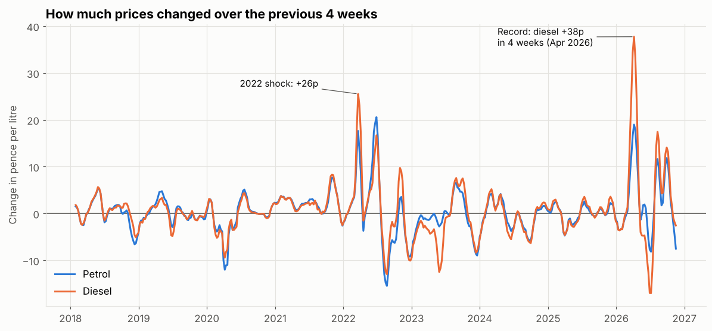
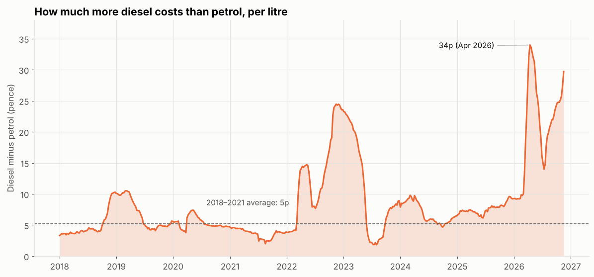

# UK fuel prices 2018–2026: a data detective project

I took 464 weeks of official UK pump prices and answered three questions with Python and pandas: **when were prices highest, how fast can they rise, and why does diesel now cost so much more than petrol?**


## Findings

**1. When were prices highest?**
Petrol peaked at **191.55p** a litre in July 2022. Diesel peaked at **200.04p** in October 2026, the first time above £2 in this data. The low point was May 2020, during the COVID lockdown, when petrol fell to 104.87p.

**2. How fast can they rise?**
In the four weeks to 6 April 2026, diesel rose **37.7p a litre**. That's the fastest rise in the dataset, and about 1.5 times the worst month of the 2022 energy crisis (+25.5p). Petrol rose 19.0p over the same weeks, so this shock hit diesel twice as hard.



**3. Why is diesel dearer?**
Not because of tax: duty and VAT are identical for both fuels in every week of the data. From 2018 to 2021, diesel cost about **5p** more per litre than petrol. Since April 2026 the gap has averaged around **24p**, peaking at 34p. Because lorries and vans run on diesel, a lasting premium pushes up the cost of moving goods.



## How it works

The notebook [`fuel_prices_analysis.ipynb`](fuel_prices_analysis.ipynb) goes through these steps:

1. **Load** the CSV with pandas.
2. **Clean** the data. I rename the 80-character column names and parse the dates with an explicit UK format (`%d/%m/%Y`), so that `03/02/2020` is read as 3 February and not 2 March. Then I remove blank and duplicate rows, check for missing weeks, and sanity-check the price range.
3. **Analyse** the data:
   - `idxmax()` and `idxmin()` find the peaks and the low point.
   - `diff(4)` gives the change over 4 weeks, which is less noisy than the weekly change.
   - `resample("YE")` gives the yearly average diesel premium.
4. **Chart** each answer with matplotlib. Each fuel keeps the same colour in every chart.

## Run it yourself

```bash
pip install -r requirements.txt
jupyter notebook fuel_prices_analysis.ipynb
```

Then choose **Run → Run All Cells**. The charts are saved to `charts/`.

**To update the data:** download the latest CSV from the [DESNZ weekly road fuel prices page](https://www.gov.uk/government/statistics/weekly-road-fuel-prices), save it as `data/weekly_road_fuel_prices_2018_2026.csv` and re-run the notebook.

## Data

- **Source:** Department for Energy Security and Net Zero, *Weekly road fuel prices* (accredited official statistics), published under the [Open Government Licence v3.0](https://www.nationalarchives.gov.uk/doc/open-government-licence/version/3/).
- **Coverage:** weekly UK average pump prices for unleaded petrol (ULSP) and diesel (ULSD), from 1 January 2018 to 16 November 2026, plus duty and VAT rates.

## Limitations

- These are national averages, so prices at individual stations and in different regions vary.
- The figures aren't adjusted for inflation.
- The data shows *what* happened, not *why*. The explanations for 2020, 2022 and 2026 come from the timing of world events, not from this dataset.

## Built with

Python 3, pandas, matplotlib and Jupyter.
