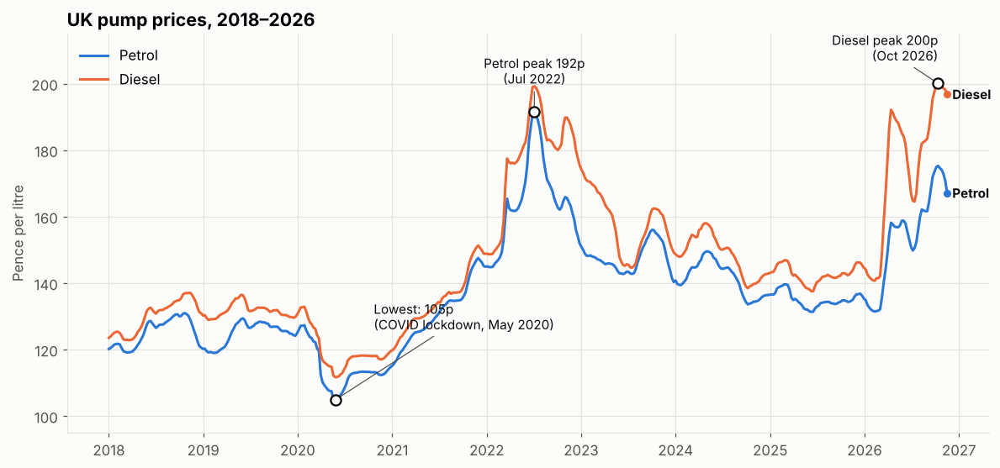

# UK fuel prices, 2018 to 2026

[](https://github.com/azmain2704-ship-it/uk-fuel-prices/actions/workflows/notebook.yml)

I wanted a data project using real numbers, so I took the government's weekly UK pump prices (464 weeks, January 2018 to November 2026) and tried to answer three questions with pandas.



## What I found

**When were prices highest?** Petrol peaked at 191.55p a litre in July 2022. Diesel hit 200.04p in October 2026, which is the first time it went over £2 in this data. The cheapest point was May 2020 during lockdown, when petrol dropped to 104.87p.

**How fast can they rise?** Faster than I expected. In the four weeks up to 6 April 2026, diesel went up 37.7p a litre. The worst month of the 2022 energy crisis was +25.5p, so this was about one and a half times that. Petrol only went up 19p over the same weeks.


**Why is diesel so much more expensive than petrol?** I assumed it was tax, but duty and VAT are exactly the same for both fuels in every week of the data. From 2018 to 2021 diesel was about 5p dearer. Since April 2026 the gap has averaged around 24p and peaked at 34p, so the difference is coming from the fuel itself.


## How I did it

Everything is in `fuel_prices_analysis.ipynb`. The data was mostly clean, but the dates are in UK format, and pandas can read `03/02/2020` as 2 March instead of 3 February without telling you. I gave it the exact format (`%d/%m/%Y`) and then checked that every row is exactly 7 days after the one before. I also renamed the columns (the originals are about 80 characters long) and checked for blank or duplicate rows.

For the analysis I used `idxmax()` and `idxmin()` to find the peaks, `diff(4)` for the change over four weeks (weekly changes were too noisy), and `resample` to get yearly averages. The charts are matplotlib.

## Running it

```bash
pip install -r requirements.txt
jupyter notebook fuel_prices_analysis.ipynb
```

Then Run All. To use newer data, download the latest CSV from the [DESNZ weekly road fuel prices page](https://www.gov.uk/government/statistics/weekly-road-fuel-prices) and save it over `data/weekly_road_fuel_prices_2018_2026.csv`.

## Limitations

These are national averages, so your local garage will be different. The prices aren't adjusted for inflation either. And the data only shows when prices moved. Linking the 2020, 2022 and 2026 changes to COVID, Ukraine and the Middle East is based on the timing, not something the dataset proves.

## Data source

Department for Energy Security and Net Zero, *Weekly road fuel prices*, under the [Open Government Licence v3.0](https://www.nationalarchives.gov.uk/doc/open-government-licence/version/3/).
